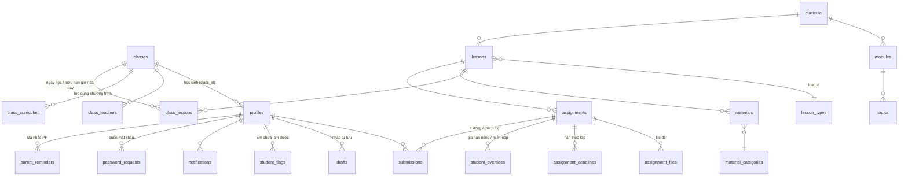

# Sơ đồ dữ liệu (ngắn)

Tên bảng/cột theo mục 11.1 spec (snake_case không dấu). Chi tiết: `supabase/001_schema.sql`.

## Ý chính
| Khái niệm | Cài đặt |
|---|---|
| Thứ tự kéo thả | `lessons.thu_tu` (text, khóa phân số — chèn giữa không đánh lại) tách khỏi `nhan_buoi` (thầy gõ, ví dụ "10–11") |
| Bản riêng cho lớp | dòng có `ghi_de_cua = id_gốc` và `class_id = lớp`; view `v_buoi_hieu_luc`, `v_bai_tap_hieu_luc` lấy bản riêng nếu có, ngược lại bản gốc |
| Một file nộp | `submissions` unique (assignment_id, student_id); nộp lại = cập nhật + ghi đè file; giữ `nop_luc_dau`, `nop_luc_moi_nhat`, `so_lan_nop` |
| Giờ nộp | ghi bởi hàm SQL `hs_nop_bai` bằng `now()` của server (không tin máy HS) |
| Trạng thái / nhãn | view `v_bai_hoc_sinh` + `lib/domain/status.ts` tính lúc truy vấn: Chưa mở / Chưa nộp / Đã nộp (Đúng hạn/Trễ) / Không nộp bài / Đã chấm / Cần nộp lại / Miễn nộp / Nộp ngoài hệ thống |
| Chấm an toàn | hàm `gv_luu_diem` so `nop_luc_moi_nhat` với mốc lúc mở bài → cảnh báo "Học sinh vừa nộp bản mới hơn"; sửa điểm đã chấm ghi `audit_log` |
| Xóa mềm | cột `deleted_at`; Thùng rác khôi phục 30 ngày; `gv_lam_sach_thung_rac` |
| Phân quyền | RLS bật cho cả 30 bảng; `is_teacher()` = toàn quyền; HS chỉ đọc dữ liệu mình + nội dung lớp mình đã mở |
| Thông báo tự động | trigger khi nộp/chấm/đăng thông báo/báo chưa làm được/quên MK; "bài mới" + "sắp đến hạn 24 giờ" sinh bởi `hs_tao_thong_bao_tu_dong` khi HS mở trang (không cần cron, không trùng) |
| File | 3 bucket riêng tư `submissions`, `materials`, `assignment-files`; tên lưu = mã ngẫu nhiên, tên gốc lưu ở bảng; tải qua link ký ngắn hạn tạo ở server (`/api/tai-ve`) |
